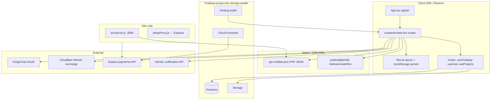

# Phase 2 — Architecture

## High-level shape

| Boundary | Responsibility |
|----------|----------------|
| `src/container/main.tsx` | Route table, Electron `HashRouter` vs web `BrowserRouter`, modal overlay pattern [CONFIRMED] `278-287` |
| `src/hooks/useFirebase.ts` | Generic Firestore CRUD + Storage uploads [CONFIRMED] |
| `src/screens/*` | Feature pages (Dashboard, Store, Admin, Website) |
| `functions/index.js` | Audio/download proxy, Espees product/payment HTTP functions [CONFIRMED] `46+`, `firebase.json` rewrites |
| `src/server.js` | Local Espees + CDN proxy mirror [CONFIRMED] |
| `workers/kingschat-callback` | Server-side OAuth code exchange + profile [CONFIRMED] |

## Entry points

| Entry | File | Role |
|-------|------|------|
| Web bootstrap | `src/index.tsx` | React 18 root, Recoil, PWA service worker **registered** [CONFIRMED] `24` |
| App shell | `src/App.tsx` | 7s splash (skipped on KC callback) → `Main` [CONFIRMED] |
| Routing | `src/container/main.tsx` | All routes [CONFIRMED] |
| Electron | `public/electron.ts` (package `main`) [CONFIRMED] `package.json:5` |
| Cloud Functions | `functions/index.js` | [CONFIRMED] |
| Dev API | `src/server.js` via `npm run server` [CONFIRMED] `package.json:106-107` |

## Critical journeys (end-to-end)

### 1) KingsChat login

1. User hits login; config from `src/config/kingschat.ts` (`REACT_APP_KINGSCHAT_*`) [CONFIRMED].
2. Redirect to KingsChat; return to `/auth/callback` (`AuthCallback` page + legacy `KingsChatCallback` route) [CONFIRMED] `main.tsx:106-109`.
3. Browser calls Cloudflare **`KINGSCHAT_WORKER_EXCHANGE_URL`** (default workers.dev URL) to exchange code; worker uses env secrets for client/API key [CONFIRMED] `kingschat.ts:17-21`, `workers/.../index.js`.
4. Tokens/user land in Recoil (`kingschatTokensAtom`, `userAtom`) [INFERRED] `store/atoms/user.ts` + auth hooks (sampled).
5. **No Firebase Auth SDK** in sampled path — session is client state + Firestore `users` docs [INFERRED] from `Protected` snapshot on `users`.

### 2) Protected dashboard / annotations

1. Routes wrap content in `<Protected>` (`DashboardRoute`, `AnnotateRoute`, etc.) [CONFIRMED] `main.tsx:112-117`.
2. `Protected` checks string `isLoggedIn === 'true'` from Recoil; on true, subscribes to Firestore `users/{id}` [CONFIRMED] `Protected/index.tsx:17-36`.
3. Dashboard hooks (`useProjects`, `useFirebase`) read/write collections: `projects`, `annotations`, `comments`, `voice-notes`, etc. [CONFIRMED] `interface/firebase.ts:1-13`.
4. **Gap:** when `isLoggedIn === 'false'`, route still renders children (auth bypass) [CONFIRMED] `Protected/index.tsx:43-44`.

### 3) Store purchase / Espees

1. Store UI loads catalog from **`https://api.rorbible.plus/prem/*.php`** [CONFIRMED] grep in `screens/Store`.
2. Payment: production uses Hosting rewrites `/espees/*` → Cloud Functions `espeesCreateProduct` / `espeesConfirmPayment` [CONFIRMED] `firebase.json:24-36`, `functions/index.js` (sampled).
3. Local: CRA dev server proxies `/espees` and `/proxy` to Express on port **3000**; React on **3400** [CONFIRMED] `setupProxy.js:22-36`, `local.sh` comments, `package.json:104`.
4. Firestore collections `scribTransactionLog`, `scribSuccessfulPayments` for payment audit [CONFIRMED] `interface/firebase.ts:9-11`.

## Data layer

| Store | Usage |
|-------|--------|
| Firestore | Primary app data; 13 named collections in `ICollections` [CONFIRMED] |
| Firebase Storage | Profile/project images, voice notes folders [CONFIRMED] `useFirebase.ts:37-44` |
| IndexedDB | Firestore multi-tab persistence enabled [CONFIRMED] `service/firebase.ts:3` (import line) |
| Recoil + persist | User/settings in localStorage via custom `module/recoil-persist` [CONFIRMED] `store/persist/persist.ts` |
| Local Bible JSON/XML | Under `src/BibleJson`, `public/bibleXML` (large static) [CONFIRMED] tree |
| Migrations | **None** in repo [CONFIRMED] no `migrations/` |
| Queues | **None** [CONFIRMED] |

## API & auth model

| Aspect | Pattern |
|--------|---------|
| REST (app) | Mostly direct client → Firestore; store catalog → rorbible.plus PHP |
| AuthN | Client-side `isLoggedIn` string + user object; KingsChat OAuth; email flows under `/auth/*` routes |
| AuthZ | Firestore rules **allow all** [CONFIRMED] `firestore.rules:3-4`; admin checks client-side [INFERRED] |
| Real-time | `onSnapshot` via `useFirebase` |

## Configuration (names only — no values)

**Build/runtime (`REACT_APP_*` via `getEnv` in `src/utils/general.ts`):**

- `REACT_APP_CI`
- `REACT_APP_EMAIL_API_URL`
- `REACT_APP_EMAIL_API_KEY`
- `REACT_APP_SCRIBBBLE_URL`
- `REACT_APP_KINGSCHAT_CLIENT_ID`
- `REACT_APP_KINGSCHAT_CHAT_CLIENT_ID`
- `REACT_APP_KINGSCHAT_LOGIN_URL`
- `REACT_APP_KINGSCHAT_REDIRECT_URL`
- `REACT_APP_KINGSCHAT_TOKEN_URL`
- `REACT_APP_KINGSCHAT_PROFILE_URL`
- `REACT_APP_KINGSCHAT_WORKER_EXCHANGE_URL`
- `REACT_APP_RORBIBLE_KINGSCHAT_REFRESH_TOKEN` (exported in `local.sh`)

**Server / Functions:**

- `PORT` (Express, default 3000) [INFERRED] `local.sh` comment
- `ESPEES_API_KEY` (`functions.config().espees.api_key` or env) [CONFIRMED] `functions/index.js:4-7`
- Cloudflare Worker: `clientId`, API keys via `env` bindings [INFERRED] worker README pattern

**Firebase client config:** hardcoded in `src/config/firebase.ts` (public Firebase web keys) [CONFIRMED].

## Phase 2 summary (5 lines)

1. **Monolithic React SPA** with large static Bible assets and Recoil state.
2. **Firestore + Storage** are the backend; generic `useFirebase` hook drives most persistence.
3. **Dual routers** (Hash for Electron, Browser for web) share one large route table in `main.tsx`.
4. **KingsChat** uses redirect OAuth + Cloudflare Worker; **Espees** via Functions (prod) or Express (dev).
5. Security architecture assumes rules enforcement — current rules are fully open [CONFIRMED].
